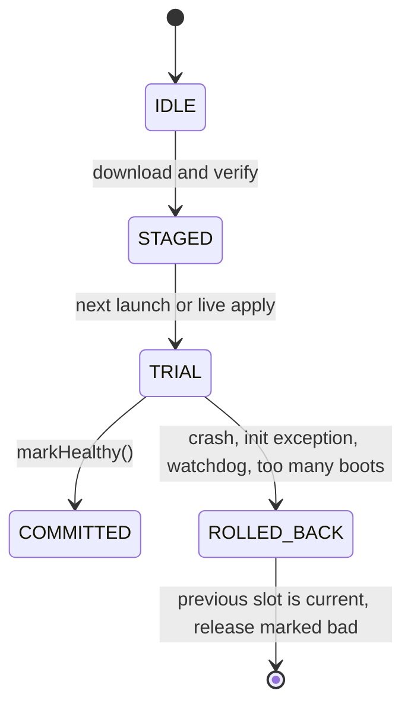

Each release lives in a **slot**. A slot moves through a small state machine.

## STAGED

The host downloads and verifies every blob (SHA-256 each), then builds the slot in
`slots/<id>.staging/`, makes dex and `.so` files read-only (Android 14+ requires this for
dynamically loaded code), fsyncs, and renames the directory to `slots/<id>/`. A slot is never loaded
from `.staging`.

## TRIAL

A new slot starts in **TRIAL**. It stays there until the payload calls `HostApi.markHealthy()` (stub
mode) or, in [transparent mode](/android/transparent-mode), until an activity has stayed resumed for
`auto_healthy_ms`. While in TRIAL:

- every launch increments `boot_attempts` **before** the slot is loaded; when it exceeds
  `max_boot_attempts` (default 2), the client rolls back without loading the slot;
- the [watchdog](/concepts/watchdog-and-crashes) rolls back if `markHealthy()` does not arrive in time;
- a crash or an initialisation failure rolls back immediately.

## COMMITTED

`markHealthy()` commits the slot. The state is written atomically: a uniquely named temp file next
to `state.json`, fsync, rename over `state.json`, fsync the directory. A reader always sees the old
or the new state, never a torn one. Every read-modify-write runs under an exclusive lock on
`state.lock`, so an updater thread and a crash handler cannot lose each other's transitions.

## ROLLED_BACK

The previous slot becomes current and the failed release is marked **bad** locally, so it is not
offered again. For a live swap the rollback happens in-process, without restarting. Otherwise the
app is relaunched at most once automatically.

<Tip>
  Rolling back on the **remote** is a different thing: `andysu rollback` republishes a known-good
  release under a higher sequence so every client moves onto it. See
  [Rollouts and channels](/publishing/rollouts-and-channels).
</Tip>

## Which slots stay on disk

Garbage collection keeps the current slot, the previous slot and any pending one. On low-storage
devices (under 200 MB allocatable) only the current one stays. The slot a process booted from is
never collected while the process still uses it. See [Deltas and cleanup](/concepts/deltas-and-gc).
