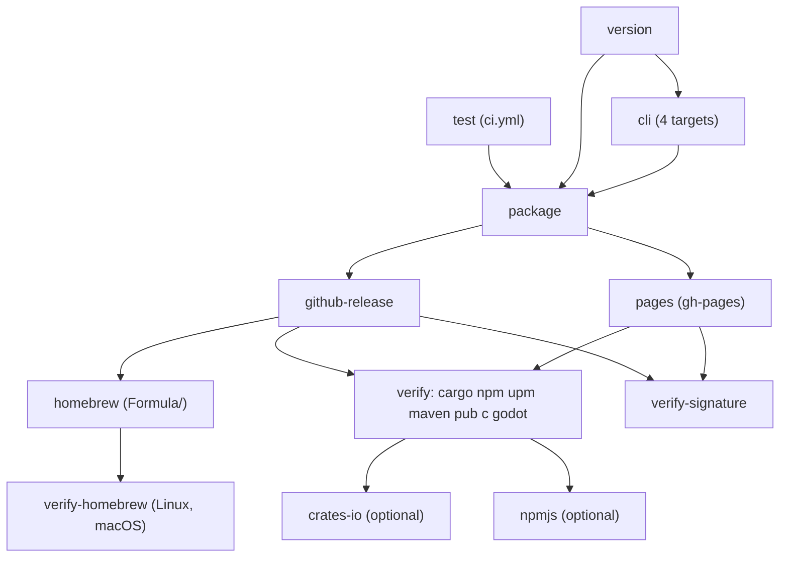

Every push to `main` that is not docs-only runs `.github/workflows/release.yml`. It publishes everything
to the project's own GitHub remote and then installs it back from the live URLs.

## Jobs

| Job | What it does |
|---|---|
| `test` | runs `ci.yml` as a reusable workflow: all the tests |
| `version` | `scripts/version.sh` computes `<VERSION>.<commit count of main>`, for example `0.1.78` |
| `cli` | builds static `andysu` binaries for `x86_64-unknown-linux-musl`, `aarch64-unknown-linux-musl` (both with `cargo-zigbuild`), `x86_64-apple-darwin` and `aarch64-apple-darwin` |
| `package` | stamps the version (`scripts/set-version.sh`), restores earlier releases from `gh-pages`, builds every package (`scripts/package.sh`), builds the demo channel and demo APK (`scripts/demo.sh`), then writes `SHA256SUMS` and signs it with `andysu sign-file` |
| `github-release` | creates release `v<version>` with the CLI binaries, AARs, crates, npm and pub tarballs, the C and Godot archives, the host template, the demo APK, `SHA256SUMS` and its signature |
| `pages` | force-pushes `gh-pages` as one commit holding every version, then waits until Pages serves the new version |
| `homebrew` | regenerates `Formula/andysu.rb` on `main` with a `[skip ci]` bot commit (up to 3 attempts; never replaces a newer formula with an older one) |
| `verify` | consumer verification: a fresh project installs the package from the live Pages and Release URLs, one matrix entry each for `cargo`, `npm`, `upm`, `maven`, `pub`, `c` and `godot` |
| `verify-homebrew` | `brew tap` and `brew install` on Linux and macOS, and checks `andysu --version` |
| `verify-signature` | downloads the release, checks `sha256sum -c` and the `SHA256SUMS` signature against `keys/andysu-release-root-public.pem`, and verifies the live demo channel with `andysu verify --blobs` |
| `crates-io`, `npmjs` | optional GitHub OIDC publishing after `verify`; disabled unless `PUBLISH_CRATES_IO=true` or `PUBLISH_NPMJS=true` is set after trusted publisher setup |

## What gets published where

- **GitHub Release `v<version>`:** CLI binaries (`andysu-<target>`), AARs, crates, npm and pub
  tarballs, `andysu-c-<version>-linux-<arch>.tar.gz`, `andysu-godot-<version>.zip`,
  `andysu-host-template-<version>.zip`, `andysu-demo-compose-<version>.apk`, `SHA256SUMS` and
  `SHA256SUMS.sig`.
- **GitHub Pages (`gh-pages`):** the static registries `maven/`, `npm/`, `cargo/` and `pub/`, the demo
  channel at `demo/stable/update.json`, and an index page.
- **`Formula/andysu.rb` on `main`:** the Homebrew tap.

## The demo channel

Each release publishes the Compose sample's payload to `<Pages>/demo/stable/update.json`, signed with
`ANDYSU_DEMO_SIGNING_KEY` (the same certified production release key), with deltas against earlier
demo releases. The demo APK attached to each release is a host with that version built in, signed
with the CI test keystore. An APK built with the current root (0.1.90 or later) live-updates to every
later release. APKs up to 0.1.81 trust the old test root and refuse the channel, so they stay on their
built-in version.

The channel's signature lasts 30 days. The weekly `resign-demo` workflow re-signs it when fewer than
14 days are left, so it stays valid when no release ships. That workflow also fails when the release
key's certificate has fewer than 30 days left.

## Public registries

Our GitHub Pages and Releases are the default. The crates.io and npmjs.com jobs use short-lived OIDC
credentials and stay off until the repository variables `PUBLISH_CRATES_IO` and `PUBLISH_NPMJS` are
enabled after trust setup. crates.io requires both crates to be published once before its trusted
publisher can be configured. npm requires bootstrap publication and a first OIDC release within two
days of configuring trust. Verify package ownership before enabling either job; see
[Keys policy](/contributing/keys-policy).

## When a release fails

Failures so far have been infrastructure (a corrupt emulator download, an emulator boot timeout), a
Homebrew formula rebase conflict (fixed), and real bugs that the verification jobs found (a transport
cut at the 8 MiB manifest limit). The history is in `docs/PROGRESS.md`, step 9. A failing release
leaves the previous release in place.
