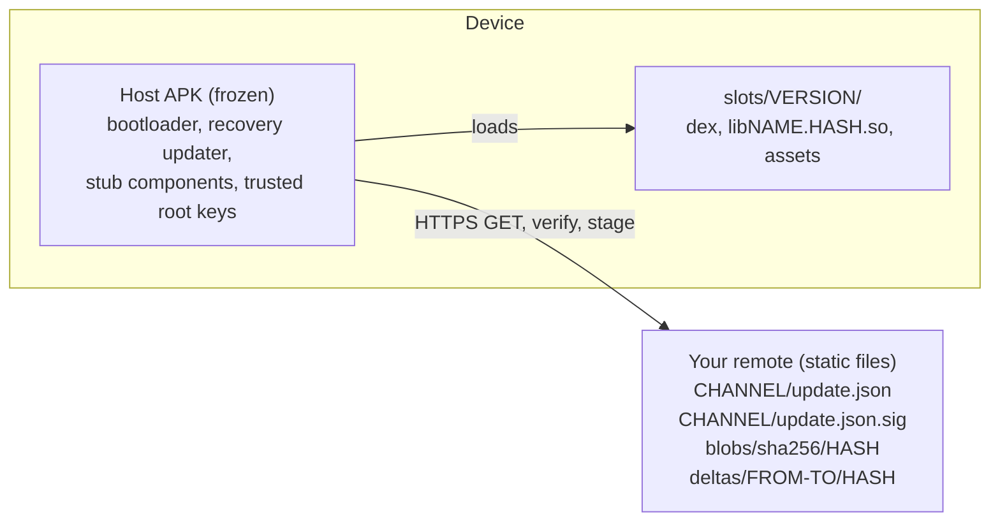

AndySU (Android Self Update) lets a sideloaded Android app update itself completely: code, native
libraries, UI and data. There is no install prompt, no "install unknown apps" permission and no
APK reinstall. Updates can apply **live** while the app is running, after a **restart**, or on the
**next start**. A release that turns out broken **rolls back** by itself.

You install a small **host APK** once. After that it never changes. Everything else is a signed
**payload** that the host fetches from a **remote you own**: a GitHub repository, GitHub Pages or any
static HTTP host.

## How it works

1. You build the payload and publish it with `andysu pack` and `andysu publish`. The channel
   manifest `update.json` is signed with your Ed25519 key.
2. The host checks the remote (on every app open and periodically in the background), verifies the
   signature **before** it parses anything, downloads only what changed, and stages the new slot.
3. The new slot runs in **TRIAL**. When it calls `markHealthy()` (or, in transparent mode, stays on
   screen for a while) it is **COMMITTED**. If it throws, crashes or hangs, the previous slot comes
   back.

## Demo

<Frame caption="A game engine's native library swapped while the game keeps running. No reinstall, no permission prompt.">
  <video
    controls
    autoPlay
    muted
    loop
    playsInline
    style={{ width: "100%", borderRadius: "8px" }}
    src="/media/andysu-xonotic-live-update.mp4"
  >
    Your browser does not support embedded video.
  </video>
</Frame>

<Note>
  The clip shows the Xonotic Touch test bed taking a live native update, which is the Host API
  level 2 path described in [transparent mode](/android/transparent-mode). The test beds are
  described in [Test beds](/contributing/testbeds).
</Note>

You can also try it on your own device. Every GitHub release carries
`andysu-demo-compose-<version>.apk`, a Compose app whose payload is published to a demo channel on
the project's GitHub Pages. Install it once (Android 6+, sideloaded) and it updates itself live to
each newer release. Use 0.1.90 or later: earlier demo APKs trust the old test root, so they refuse
the channel. The channel is signed with the certified release key and the APK with the CI test
keystore, see [Keys policy](/contributing/keys-policy).

## What AndySU is

- A frozen **host** plus signed **payloads**: dex, native libraries, assets and AndySU's own
  updater, all replaceable without touching the APK.
- A **CLI** (`andysu`) that packs, signs and publishes releases, and splits any finished APK into
  host and payload.
- An **Android host library** (AAR), a **Gradle plugin**, and **bindings** for Flutter, React Native
  and Expo, Capacitor and Cordova, Unity, Godot and C.
- An open **protocol** ([manifest format](/reference/manifest-format)) that anyone can implement.

## What AndySU is not

- It is **not for Google Play or F-Droid.** Google Play does not allow apps to download executable
  code (dex or `.so`) from outside Play, and F-Droid requires in-app updaters to be off. AndySU is
  for apps distributed outside those stores: direct downloads, GitHub releases, enterprise and
  kiosk deployments, games shipped from your own site. It does not try to work around either
  policy. See [Security](/security).
- It does **not** replace the host APK. A change to the host itself (new permissions, new stub
  components, a higher Host API level) needs a reinstall. `andysu pack` refuses a payload that
  needs more than the frozen host declares.
- It does **not** prove that code is benign. It proves that the code came from the holder of the
  signing key.
- It has **not** been run on a physical phone yet. See [what is verified](#what-is-verified).

## Requirements

- Android 5.0+ (API 21) for the host. Transparent mode needs API 28, or API 30 when the payload has
  assets.
- Works with Android 14 read-only code rules and 16 KB page sizes.

## What is verified

The project keeps an honest status log in
[`docs/PROGRESS.md`](https://github.com/dixonSolutions/AndySU/blob/main/docs/PROGRESS.md). In short:

- The device test suite runs in CI on API 24, 29, 31, 34, 36 and 36 with 16 KB pages, and passed
  21/21 on a BlissOS VM (Android 13, x86_64). It has **not been run on a phone**.
- The Xonotic and SuperTuxKart test beds pass built-in, next-start update, and rollback of a
  broken release. The live native swap of Xonotic passes on an API 34 emulator.
- Flutter's tests run only in CI. The Godot and Unity runtimes were not exercised (no Godot, and
  Unity needs a licence); their Android and C# sides compile.

## Where to go next

<CardGroup cols={2}>
  <Card title="Your first live update" icon="bolt" href="/tutorials/first-live-update">
    A Compose app that swaps in a new release while it is on screen, step by step.
  </Card>
  <Card title="Ship an existing APK" icon="box-open" href="/tutorials/existing-apk">
    Flutter, React Native, Unity, Godot or a native game, without code changes.
  </Card>
  <Card title="Quickstart" icon="rocket" href="/quickstart">
    Install the CLI, create keys, integrate, publish your first update.
  </Card>
  <Card title="Concepts" icon="book" href="/concepts/host-and-payload">
    Host and payload, slots, trial and rollback, the watchdog, manifests.
  </Card>
  <Card title="Android integration" icon="mobile-screen" href="/android/gradle-plugin">
    The Gradle plugin, host config, the Host API, `andysu split`.
  </Card>
  <Card title="Remotes and publishing" icon="cloud-arrow-up" href="/publishing/remotes">
    GitHub releases, GitHub Pages or any static host.
  </Card>
</CardGroup>
