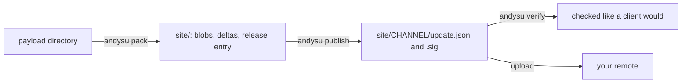

A release goes through three commands. Full flag lists are in the [CLI reference](/reference/cli).



## 1. Pack

```sh
andysu pack <payload> --site site --host andysu-host.json
```

`pack` turns a payload directory into a release inside a site directory. It:

- renames native libraries to `lib<name>.<hash8>.so`, rewriting SONAME and `DT_NEEDED` (skip with
  `--no-rename`);
- warns about libraries that are not 16 KB aligned (`--require-16k` makes it an error);
- **fails** when the payload needs a permission or component the frozen host does not declare
  (`--host andysu-host.json`), or a Host API level above the host's (`--allow-shell` permits it for a
  tier C shell update);
- hashes everything into content-addressed blobs;
- builds deltas against the last N releases of the channel (`--deltas`, default 3;
  `--delta-format zstd` or `bsdiff`);
- bundles directories with more than 400 loose files into zip components, and any directory you name
  with `--archive`;
- marks content under `--hot` prefixes as `apply: hot`;
- for a GitHub remote, `--base-url` sets the absolute URL prefix of new blobs.

The release id defaults to the payload's version; override it with `--id`. `--channel` defaults to
`stable`.

<Tip>
  `--emit-slot <dir>` also writes the release as a ready slot directory with an `andysu-slot.json`
  index. That is the built-in payload for a host APK.
</Tip>

## 2. Publish

```sh
andysu publish --site site --release 1.1 --key andysu-root.key
```

`publish` adds the packed release to the channel manifest and signs it.

| Flag | Default | Meaning |
|---|---|---|
| `--channel` | `stable` | channel |
| `--rollout PERCENT` | none | roll out to this share of installs (salt is the release id) |
| `--mandatory` | off | mark the release mandatory |
| `--notes-url` | none | link to release notes |
| `--keep` | 5 | how many releases stay in the manifest |
| `--key` | `$ANDYSU_KEY_FILE` | signing key |
| `--cert` | `$ANDYSU_CERT_FILE` | certificate when signing with a release key |
| `--expires-days` | 30 | days until the manifest expires |

After publishing, upload the site to your remote. With the publish action this is automatic.

## Other commands

- **`andysu sign`** re-signs a channel manifest to refresh its expiry, or changes a rollout:
  `andysu sign --site site --rollout 1.1=50 --key andysu-root.key`.
- **`andysu rollback`** republishes a known-good release with a higher sequence:
  `andysu rollback --site site --to 1.0 --key andysu-root.key`. See
  [Rollouts and channels](/publishing/rollouts-and-channels).
- **`andysu verify`** checks a manifest (a path or a URL) the way a client does: signature, app,
  channel, expiry. `--blobs` also downloads and hashes every blob and delta.

  ```sh
  andysu verify https://example.com/updates/stable/update.json --pub andysu-public.pem --blobs
  ```

- **`andysu serve`** is a static server with Range and ETag support, for local remotes and tests. It
  can inject faults (`--drop-after`, `--throttle-kbps`).

  ```sh
  andysu serve site --addr 127.0.0.1:8787
  ```

## Hot updates

Content that your payload can re-read without restarting is marked hot at pack time:

```sh
andysu pack payload --site site --hot assets/ --host andysu-host.json
```

A release whose only changes are hot content applies in place and calls
`Payload.onContentUpdated`. See [Apply policies](/concepts/apply-policies#hot-content-only-updates).

## Re-sign before expiry

Manifests expire after `--expires-days` (default 30), which protects clients from freeze attacks.
Schedule `andysu sign` in CI, or use the [remote template](/publishing/rollouts-and-channels), which
re-signs weekly.
